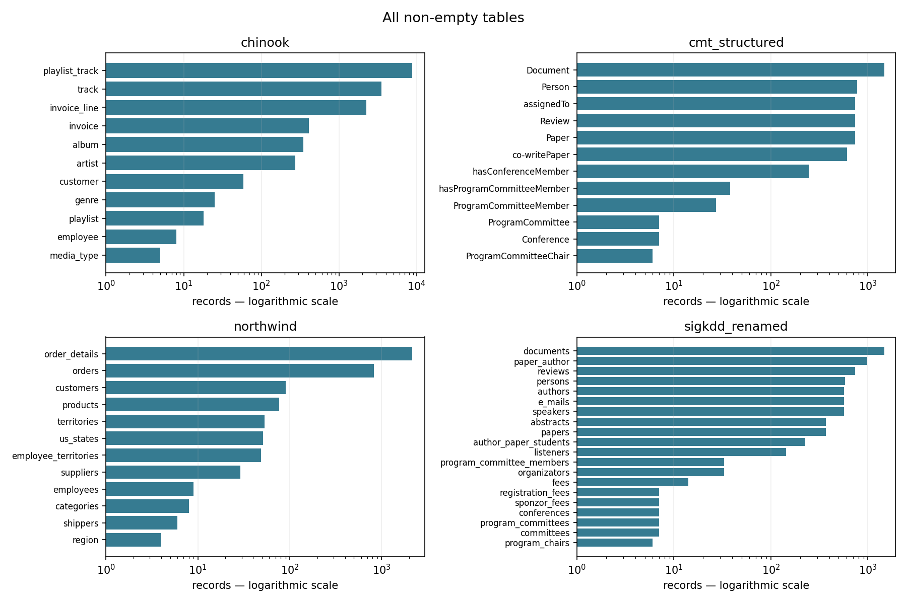

# EDA for LLM4VKG

## Objective and scope

Datasets:

- RODI
    - cmt_structured
    - sigkdd_renamed
- Northwind
- Chinook

All **31,032 records across 115 tables** were analyzed. SQL dumps were imported into separate temporary PostgreSQL databases.

## Data size and quality

| Dataset | Tables | Records | Columns | Empty tables | NULL |
|:--|--:|--:|--:|--:|--:|
| CMT structured | 32 | 5,386 | 85 | 20 | 19.46% |
| SIGKDD renamed | 58 | 6,677 | 93 | 38 | 10.33% |
| Chinook | 11 | 15,607 | 64 | 0 | 2.01% |
| Northwind | 14 | 3,362 | 92 | 2 | 2.76% |

No duplicate or NULL primary keys, NOT NULL violations, or orphan references were found across **140 declared foreign keys**. No empty strings or whitespace-only values were detected. Foreign key checks covered only relationships declared in the databases.

## Missing data and example availability

A total of **60 tables are empty**, and **17 columns in non-empty tables contain only NULL**: 12 in CMT and 5 in SIGKDD. In CMT, these include paper acceptance or rejection decisions and some conference attributes; in SIGKDD, examples include nationality and currency. Overall, 24 columns in non-empty tables have more than 50% NULL. Missing values in Chinook include customer company and fax details; in Northwind, they include regions and supplier websites.

Values are available in **34/85 CMT columns**, **35/93 SIGKDD columns**, **64/64 Chinook columns**, and **88/92 Northwind columns**. Empty tables and columns without values cannot provide examples, but still describe the schema.

## Can instance values help matching?

Paper titles in both RODI scenarios resemble artificial word combinations, such as “acridities unrealistic substituting surges preheats loggias”. Chinook and Northwind contain recognizable artist, album, and category names, such as “AC/DC” and “Beverages”. This suggests greater semantic potential for examples in these two datasets
Identifiers and artificial text may provide little information about column meaning.

## Ontologies and evaluation material

Ontologies were analyzed in TTL format without OWL reasoning. CMT contains **468 triples, 30 classes, 49 object properties, and 11 datatype properties**; SIGKDD contains **371, 49, 21, and 18**, respectively. Triple counts describe the ontology graph, rather than a record graph or the resulting VKG. No explicit class instances or NamedIndividual declarations were found; ontology relationships are nevertheless present, including 33 and 49 subclass axioms.

CMT provides labels for **89 of 90 terms** and comments for 12. SIGKDD has no labels, but provides comments for **84 of 88 terms**. Descriptions prepared for the matcher should therefore include names, labels, comments, and ontology structure.

## Conclusions

The main limitations are the lack of examples across much of the RODI schemas and the varying semantic value of available data. The matcher should use names, types, PK/FK relationships, and ontology descriptions, supplemented with selected values.
